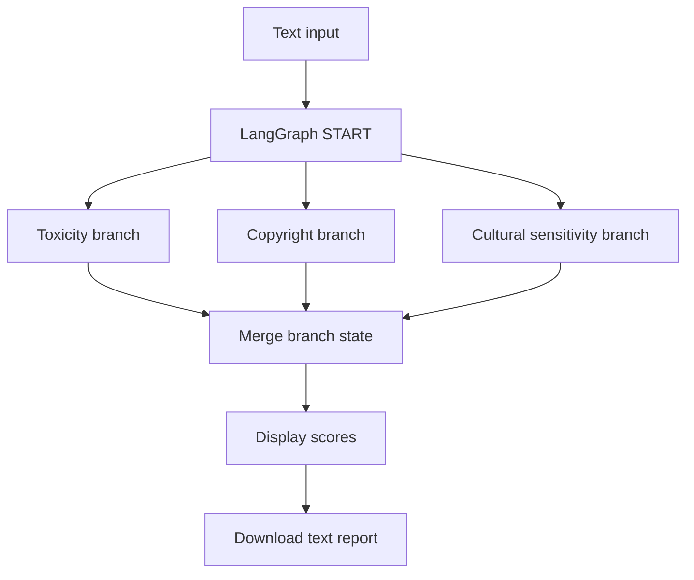

# Content Safety Analyzer

A Streamlit application that evaluates submitted text across three separate content-review dimensions: toxicity and hate speech, copyright risk, and cultural sensitivity.

The application uses a LangGraph workflow with three parallel analysis branches. Each branch calls the Groq-hosted `openai/gpt-oss-20b` model and returns an integer risk estimate between 0 and 100.

## Features

- Analyze text such as a script, caption, comment, or transcript.
- Run toxicity and hate-speech analysis.
- Estimate potential copyright risk.
- Estimate cultural sensitivity risk.
- Execute the three analysis branches in parallel through LangGraph.
- Display the three scores and a simple average overview.
- Download a text summary of the results.
- Load sample text or clear the input.

## Workflow



| Branch | What it evaluates | Output key |
|---|---|---|
| Toxicity | Toxicity, hate speech, harassment, and abusive language | `toxicity_level` |
| Copyright | Potential unauthorized reproduction or substantial similarity | `copyright_risk` |
| Cultural sensitivity | Cultural insensitivity, stereotypes, disrespect, or offensive references | `cultural_insensitivity` |

The three scores are generated independently and merged into the LangGraph state.

## Tech Stack

- **Python**
- **Streamlit** — user interface
- **LangGraph** — parallel branch orchestration and state merging
- **LangChain Groq** — LLM interface
- **Groq model** — `openai/gpt-oss-20b`
- **python-dotenv** — environment variable loading

## Project structure

```text
Content_saftety_analyzer/
├── app.py
├── project.py
├── requirements.txt
└── .env                 # Create locally; never commit secrets
```

## Getting started

### Requirements

- Python 3.10+
- Groq API key

### 1. Clone the repository

```bash
git clone https://github.com/srini526/Content_saftety_analyzer.git
cd Content_saftety_analyzer
```

### 2. Create a virtual environment and install dependencies

```bash
python -m venv .venv
```

**Windows PowerShell**
```powershell
.\.venv\Scripts\Activate.ps1
```

**macOS / Linux**
```bash
source .venv/bin/activate
```

Install:

```bash
pip install -r requirements.txt
```

### 3. Configure the Groq API key

Create a root `.env` file:

```env
GROQ_API_KEY=your_groq_api_key
```

The app also supports Streamlit Cloud Secrets. Never commit a real API key.

### 4. Run the application

```bash
streamlit run app.py
```

Paste text, select **Analyze content**, and review the generated scores.

## Understanding the scores

Scores are estimates produced by an LLM from the supplied text. The UI displays them on a 0–100 scale. The average shown by the app is a simple arithmetic average for display; it is not a validated combined-risk metric.

A score is not a legal determination of copyright infringement and should not be treated as a definitive moderation decision. Human review and additional context are required before consequential action.

## Limitations

- The system does not use a dedicated copyright-matching database or plagiarism detection engine.
- A model-generated risk estimate cannot determine ownership, fair use, licensing, or legal infringement.
- Cultural sensitivity and toxicity are context-dependent; LLM scores can miss nuance or produce false positives/negatives.
- The current output is a set of risk estimates rather than a detailed explanation with highlighted text spans.
- If the model returns an invalid integer, the current branch falls back to a score of zero; this may conceal a model-output problem and should be reviewed carefully.

---

A small multi-branch LangGraph project exploring parallel LLM-based content review.
